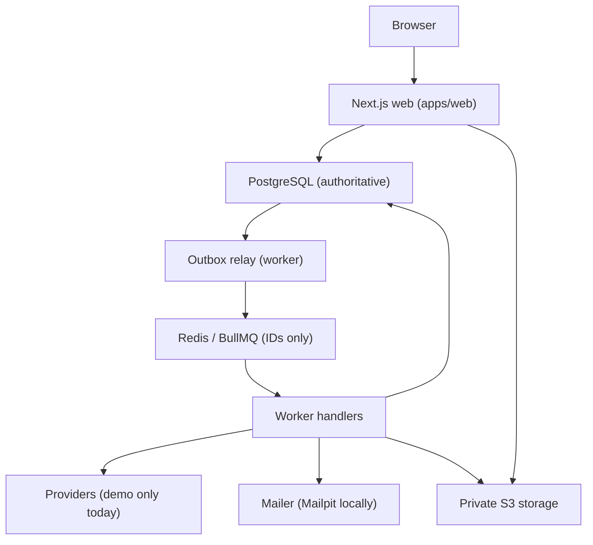

# Architecture

BuyTrail is a modular monolith with a separately running worker (Section 7).

## Packages

| Package | Responsibility |
| --- | --- |
| `packages/domain` | Pure rules. Integer money; GTIN/MPN normalization; exact-variant matching; eligibility and ranking; freshness and anomaly checks; watch state machine (hysteresis, episodes, cooldown); DST-aware reminder planning; signed cursors. Inputs, including the clock, are passed explicitly. |
| `packages/config` | Zod-validated environment. Live mode rejects local secrets, http URLs, local email, and uploads without a scanner. |
| `packages/db` | Prisma 7 schema, migrations (constraints, partial indexes, FTS/trigram, generation sequence), and the client with a retrying `withTx`. |
| `packages/providers` | `CatalogProvider` contract and validation, the deterministic demo catalog/provider, and the authorized-CSV parser. |
| `packages/services` | Application services: catalog reads, ingestion, watches, notifications, purchases/reminders, receipts, account, admin, outbox, jobs, storage, mailer. |
| `apps/worker` | BullMQ consumer, relay/reconciler, scheduler loops, heartbeat. |
| `apps/web` | Pages, route handlers (Section 18), Better Auth magic-link sign-in. |

## Key flows

**Ingestion (Section 11).**
1. `claimRefresh` locks the listing row and allocates a monotonic generation from `eval_generation_seq`, with a lease.
2. The provider is called outside any transaction, with a timeout and a reserved source budget.
3. `acceptObservation` validates the record, stores an immutable observation (only when history is permitted), and updates `offer_quote` only if the claim's generation is newer than the applied one (G14).
4. It then bumps `variant_eval_generation` and enqueues `watch.evaluate_variant` in the same transaction.

Timeouts record a check failure and leave business state untouched (G10). 429 Retry-After and circuit-breaker state are persisted on `source` (G15). A suspicious price becomes `pending_verification` and triggers an independent re-check; it can alert only after `confirmed` (G16).

**Watch evaluation (Section 19).** Each watch is evaluated under `SELECT … FOR UPDATE`, against the input generation read inside the lock. A crossing increments the episode and inserts a `notification_event` with logical key `watch:{id}:v{ruleVersion}:episode:{n}` (unique), plus an email delivery and outbox row, all in one transaction (G12, G13). The expiry sweep bumps generations when quotes go stale, so "no eligible offer" is evaluated as `unknown` (G11, G28).

**Delivery guarantee (Section 21).** In-app events are durable, one per logical key. Email is *at most once per logical delivery from BuyTrail's side*:
- Revalidation runs immediately before sending: user active, preferences, watch active, current rule version, offer still eligible and meeting the target, cooldown, per-user and global limits.
- `sendStartedAt` is committed before the SMTP call.
- An ambiguous result (timeout mid-conversation, or a crash after `sendStartedAt`) is reconciled through the Mailpit lookup when one is available. Otherwise it is marked `unknown_outcome` and **not resent** (G18).
- Definite non-sends (connection refused, 4xx) retry with jittered backoff.

We do not claim exactly-once email.

**Outbox and recovery (Section 20).** Work intent is written in the same transaction as the state change. On every tick (2 s), the relay publishes:
- undispatched rows;
- rows dispatched more than 60 s ago that were never claimed (queue loss);
- rows whose lease has expired (worker crash).

Each publish gets a fresh job ID, so BullMQ deduplication cannot swallow a republish. The real deduplication is the handler's conditional claim. Flushing Redis loses nothing that was committed (G17; tested against real Redis).

**Reminders (Section 22).** Due times live in `reminder_schedule` (UTC instants plus a local label). Every deadline edit bumps the generation and cancels other generations. The processor locks each due row (`SKIP LOCKED`) and re-checks generation, item and purchase status, and account state before creating the event (G20, G24). Past offsets are stored as `skipped_past`, never burst-sent.

**Receipts (Section 23).**
1. An upload intent is bound to the owner and receipt ID; the object key stays server-side.
2. Bytes go to `PUT /api/receipts/:id/content`, which enforces the exact declared size and type and writes to `quarantine/`.
3. Confirm, then the worker validates: magic bytes, a structural PDF scan for active content, and a bounded sharp decode with a re-encoded preview.
4. The file moves to `receipts/` and the state becomes `ready`.

Downloads stream through an authenticated, owner-checked route with `nosniff` and a sandbox CSP, so revocation is immediate. Demo mode refuses arbitrary uploads; bundled synthetic samples go through the same pipeline (G30).

## Decisions

See `docs/decisions/`. The main ones:
- Prisma 7 with the `pg` driver adapter.
- Better Auth magic links.
- SeaweedFS replaces MinIO locally (0002).
- One BullMQ queue carrying outbox IDs.
- Authenticated streaming instead of signed URLs.
- Before-tax comparison only.
- The in-process rate limiter is per instance.
